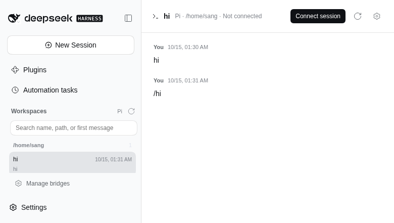
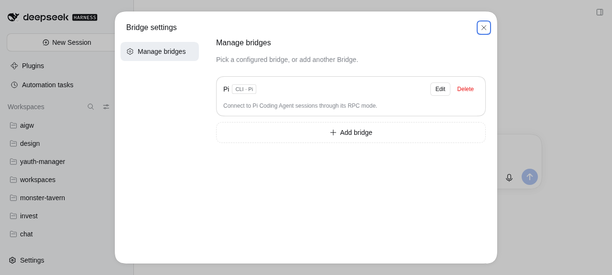

# dsh-bridge

Bridge **Pi Coding Agent** sessions into the **DeepSeek Harness (dsh)** web UI.

This repository currently implements the **Pi bridge only**: the host plugin
lists Pi sessions, attaches to a Pi process over the documented RPC protocol,
streams agent events into dsh, and sends prompts, steering messages, and aborts
back to Pi.

The browser panel lists Pi sessions, shows the current branch, attaches a Pi
child on demand, renders streaming Markdown, thinking and tool calls, sends
prompts, aborts a turn, and forwards blocking extension dialogs.

The page uses the same `dsh-client-ui-primitives` and `--dsw-*` tokens as the
shipped chat surface (centred content column, dsh Markdown, disclosure rows,
composer card).

## Status

- [x] Read Pi session files (`~/.pi/agent/sessions/**/*.jsonl`)
- [x] Current-branch reconstruction, tool-call extraction, list previews
- [x] Pi RPC process attachment
- [x] Event fan-out and prompt/steer/abort routes
- [x] dsh browser panel (Bridge main panel + sidebar entry + header settings)
- [x] Persisted backend selection (Pi only for now)
- [ ] Install into a dsh profile

## How it works

```text
Browser
  └─ dsh web
       └─ @gitsang/dsh-bridge (host plugin)
            ├─ session-store.js   read-only Pi JSONL listing/history
            └─ pi-attachment.js   spawn `pi --mode rpc --session <file>`
                 │ JSONL over stdin/stdout
                 ▼
            Pi Coding Agent
```

Pi's RPC mode is the stable integration point: commands are JSON lines on
stdin, responses and events are JSON lines on stdout. The bridge never writes
the session file itself, so it cannot corrupt Pi's branch structure.

## Host routes

All routes sit below dsh's authenticated `/api` channel and inherit its
Host/Origin fence and signed browser cookie.

| Route | Purpose |
| --- | --- |
| `GET /api/pi-bridge/sessions` | List Pi sessions (read-only JSONL scan) |
| `GET/PUT /api/pi-bridge/settings` | Read or update the backend and Pi settings |
| `GET /api/pi-bridge/session?key=…` | One session with current-branch history |
| `GET /api/pi-bridge/capabilities` | Bridge protocol and live attachment table |
| `POST /api/pi-bridge/attach` | Spawn `pi --mode rpc --session <file>` |
| `POST /api/pi-bridge/detach` | Close the owned Pi child |
| `GET /api/pi-bridge/state?key=…` | `get_state` snapshot |
| `GET /api/pi-bridge/events?key=…` | SSE stream of Pi events and extension UI |
| `POST /api/pi-bridge/prompt` | Prompt, steer, or follow up |
| `POST /api/pi-bridge/abort` | Abort the running turn |
| `POST /api/pi-bridge/ui-response` | Answer a blocking extension dialog |
| `GET /api/pi-bridge/models?key=…` | Provider/model catalog |
| `GET /api/pi-bridge/history-message?key=…` | Concatenated plain-text history |

A session is keyed by a base64url encoding of its absolute JSONL path. The Host
rejects any key that resolves outside the configured Pi sessions root.

## Configuration

Environment variables read by the host plugin:

| Variable | Default | Meaning |
| --- | --- | --- |
| `PI_BIN` | auto | Pi executable. Resolution order: `$PI_CODING_AGENT_DIR/bin/pi`, `~/.pi/agent/bin/pi`, the `@earendil-works/pi-coding-agent` package visible to dsh, then `pi` on `PATH` |
| `PI_BRIDGE_OFFLINE` | `1` | Start attached Pi with `PI_OFFLINE=1` so startup never installs packages or writes the agent directory. Set `0` to allow online startup |
| `PI_CODING_AGENT_DIR` | `~/.pi/agent` | Pi config directory |
| `PI_CODING_AGENT_SESSION_DIR` | `$PI_CODING_AGENT_DIR/sessions` | Session storage root |

## Browser panel





The client half registers:

- a **Bridge** entry in the sidebar panel list;

- a `main` panel that renders the session list, transcript, composer, and
  extension dialogs.

Backend settings live in `$DSH_HOME/pi-bridge.json` (mode 0600). `backend`
selects the agent backend (Pi is the only entry), `pi.sessionsRoot` overrides
the session directory, `pi.binary` overrides `PI_BIN`, and `pi.offline` starts
attached Pi with `PI_OFFLINE=1`. The Host refuses backend or root changes while
a Pi child is attached.

It talks only to the host routes above, with `credentials: 'same-origin'`.
Live updates arrive over `EventSource`; the host keeps a bounded event ring so
a reconnecting browser can catch up.

## Development

```bash
npm test              # unit tests
npm run test:secrets  # fail if a tracked file looks like a credential
```

### Live verification

`tests/` holds opt-in tooling that drives a running `dsh web`. It reads the
local browser-session signing secret from `$DSH_HOME/.credentials.yaml` only to
mint an in-memory cookie, so the secret is never printed, logged, or written to
disk, and `npm run test:secrets` guards tracked files against leaks.

```bash
node tests/live-smoke.mjs                    # read-only checks
DSH_SMOKE_ATTACH=1 node tests/live-smoke.mjs # attach, prompt, stream, detach
node tests/live-setup.mjs                    # point the profile at this checkout
```

`tests/lib/browser-cookie.mjs` and `tests/lib/dsh-rpc.mjs` are the reusable
pieces.

`scripts/dev-rpc.sh` is a local debugging helper for calling a dsh Remote
endpoint with a signed browser cookie. It is not loaded by the plugin. Set
`DSH_BROWSER_SECRET` from `~/.dsh/.credentials.yaml` and call it as
`scripts/dev-rpc.sh pluginManager/listBundles '{}'`.

## License

MIT
